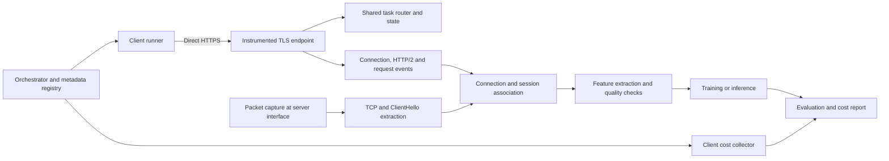

# Beyond Handshake Mimicry — Master Build Document

**Project:** Measuring the limits and cost of browserless automation detection
**Document version:** 1.0 · 21 October 2026
**Status:** Implementation specification. The software, experiments, and results described here have not yet been built or run.
**Audience:** The student building the project, an AI coding agent implementing it, and a supervisor reviewing the research design.
**Suggested repository name:** `beyond-handshake` · Python package: `beyond_handshake` · CLI: `bh`

## How to use this document

Read sections 1–8 before writing code. Implement the numbered build phases in section 9 in order. Each phase defines what to code, how to implement it, what to verify, and an agent assignment. Later sections specify the experiments, analysis, release, and troubleshooting. A phase is complete only when its acceptance gate passes and the evidence is saved.

All repository paths below are relative to the project root. All `bh` commands are **interfaces to implement**, not commands that already exist. Configuration examples specify intended behavior; the implementation must validate them. Shell commands for installed external tools are examples to verify on the selected operating system. Numbers labeled defaults or targets are design choices to freeze after a pilot, not measured results or promises of statistical power.

The initial deliverable is a controlled research instrument and reproducible experiment. An attractive demo is a later deliverable. A high detection rate is not a completion requirement: an accurately measured failure of detection is a legitimate outcome.

### Navigation

- [1. Research objective and permitted claims](#1-research-objective-and-permitted-claims)
- [2. Scope, resources, and completion levels](#2-scope-resources-and-completion-levels)
- [3. Architecture and observation boundaries](#3-architecture-and-observation-boundaries)
- [4. Stack and dependency decisions](#4-stack-and-dependency-decisions)
- [5. Repository layout](#5-repository-layout)
- [6. Data contracts](#6-data-contracts)
- [7. Workloads and client contracts](#7-workloads-and-client-contracts)
- [8. Feature specification](#8-feature-specification)
- [9. Build phases and AI-agent assignments](#9-build-phases-and-ai-agent-assignments)
- [10. Experiment protocol and sample planning](#10-experiment-protocol-and-sample-planning)
- [11. Statistical analysis and acceptance of findings](#11-statistical-analysis-and-acceptance-of-findings)
- [12. CLI and operational runbook](#12-cli-and-operational-runbook)
- [13. Optional extensions](#13-optional-extensions)
- [14. Failure modes and troubleshooting](#14-failure-modes-and-troubleshooting)
- [15. Delivery, report, and demonstration](#15-delivery-report-and-demonstration)
- [16. Schedule and scope reduction](#16-schedule-and-scope-reduction)
- [17. Global coding-agent instructions](#17-global-coding-agent-instructions)
- [18. Final acceptance checklist](#18-final-acceptance-checklist)
- [19. Sources and prior-art position](#19-sources-and-prior-art-position)

## 1. Research objective and permitted claims

### 1.1 Main question

**Which server-observable signals remain useful for distinguishing browserless automation from real browser stacks after TLS and HTTP/2 impersonation, across unseen client implementations and environments?**

Secondary question: **What runtime, network, and compute costs accompany progressively more complete imitation, at comparable task success?**

The proposed contribution is a controlled measurement study, an instrumented collector, a reusable dataset, and a transparent detector. It is not the invention of cross-layer fingerprinting. Existing HTTP/2 fingerprinting, JA4 signals, and recent agent-fingerprinting studies must appear in the related-work section. See section 19.

### 1.2 Labels and what they mean

Store two separate axes in metadata:

| Axis | Values | Purpose |
|---|---|---|
| Execution stack | `browser`, `browserless` | Primary prediction target |
| Controller | `human`, `script`, `llm` | Experimental factor, not automatically the target |
| Client implementation | Registered family and exact version | Generalization grouping |
| Imitation configuration | Explicit capability vector and stage | Cost and robustness analysis |

For the primary model: `y=1` means browserless automation; `y=0` means a real browser stack. Both manually used Chrome and Playwright-controlled Chrome are negative examples. A browser-based LLM agent is also negative for this target. A browserless LLM agent is positive. Do not train all automation as positive and still describe the result as browser-stack detection.

Report the false-positive rate on human-browser sessions separately from that on automated-browser sessions. A legitimate API client may be classified as browserless correctly; this does not imply maliciousness. The detector does not establish identity, intent, authorization, or AI reasoning.

### 1.3 Hypotheses to preregister

- **H1:** Protocol and application features improve detection over TLS-only features on a held-out browserless implementation family.
- **H2:** Improvements shrink as measured impersonation fidelity increases.
- **H3:** Additional resource and state behavior changes runtime or resource consumption; the size and direction are empirical questions.
- **H4:** Some apparent gains disappear after balancing operating system, task, and capture conditions.
- **H5, optional:** A controlled server-response intervention adds information beyond static handshake features.

A hypothesis is not a promised result. Do not remove difficult clients, unsuccessful hypotheses, or inconvenient feature groups after seeing test outcomes.

### 1.4 Main deliverables

1. TLS-terminating measurement server with HTTP/2 and HTTP/1.1 support.
2. Synthetic task website with a server-side task-success oracle.
3. Client adapters and reproducible run orchestrator.
4. Packet and server-event pipeline with verified session association.
5. Versioned features, split manifests, and baseline models.
6. Measured imitation-fidelity and resource-cost experiments.
7. Report with uncertainty, ablations, failure analysis, and reproducible figures.
8. Local demonstration and sanitized release package.

## 2. Scope, resources, and completion levels

### 2.1 Default assumptions

Plan for one developer or a small student team, roughly 10–12 weeks, a Linux development machine with approximately 16 GB RAM, and access to a second machine or VM for meaningful network experiments. No GPU is required. These are planning assumptions; record actual hardware in the environment manifest.

Local loopback is suitable for parser and orchestration development. It is not enough to substantiate network-environment robustness. Prefer direct client-to-server traffic on a controlled LAN for the primary measurements. Use separate machines when measuring CPU and latency so server processing does not compete with the client. If this is impossible, disclose the shared host and avoid claims about deployment performance.

Reserve storage after measuring pilot capture size. Do not assume a fixed disk requirement: projected bytes = median bytes per run × planned runs × replication factor, plus derived artifacts. Keep a safety margin and a configurable disk-space abort threshold.

### 2.2 Included in the primary project

- HTTPS over TCP, with negotiated HTTP/2 or HTTP/1.1.
- Direct observation at the endpoint that terminates client TLS.
- Chrome-family baseline, manually operated and automated.
- Multiple independently implemented browserless client families.
- Controlled shopping/search/form tasks using synthetic data.
- Offline session classification, followed by a small streaming demonstration.
- Server-observed features for prediction; client telemetry only for evaluation cost.
- Explicit missingness and measurement-quality handling.

### 2.3 Deferred by default

HTTP/3/QUIC, internet-wide measurements, third-party WAF bypass benchmarks, IP reputation, JavaScript fingerprint collection, mouse biometrics, production blocking, distributed microservices, large deep-learning models, and claims of universal AI detection. Ordinary JavaScript may implement the task website; it must not supply hidden browser telemetry to the primary detector.

Keep AI-versus-script experiments, active server interventions, and calibrated abstention as separate optional modules. They do not delay the core study.

### 2.4 Completion levels

| Level | Requirements | Claims allowed |
|---|---|---|
| Engineering MVP | One browser, one strong impersonator, verified telemetry and an end-to-end classifier | Pipeline works on tested configurations |
| Research core | Independent client families, locked splits, matched environments, fidelity and cost study | Results for the specified held-out families and conditions |
| Extended study | Additional OS/network/version shifts or active probes | Only the specific additional generalization tested |

If only one implementation family is available, finish the engineering MVP but explicitly downgrade the research claim. A Python binding and its underlying command-line binary do not constitute two independent families.

## 3. Architecture and observation boundaries



### 3.1 One component owns the original client connection

Use a small purpose-built Python `asyncio` TLS endpoint, `h2` for the HTTP/2 state machine, and `h11` for HTTP/1.1. Route both to the same task application. The custom code instruments existing protocol implementations; it does not implement TLS, HPACK, or HTTP protocol validation from scratch.

Do not place nginx, a CDN, a TLS interception proxy, or an ordinary reverse proxy in front of the collector for the primary experiment. Such a component may replace the TLS/TCP/HTTP connection being measured. If later testing a proxy environment, explicitly define whether it tunnels TCP, terminates TLS, or creates a new upstream HTTP connection.

The server's TLS context advertises `h2` and `http/1.1`. Dispatch using negotiated ALPN. No-ALPN clients may use HTTP/1.1 under a documented policy. Never route HTTP/1.1 bytes into the HTTP/2 parser. Record protocol fallback as an observation, not as a silent repair.

### 3.2 Signal ownership

| Signal | Collection point | Important limitation |
|---|---|---|
| Client SYN, MSS, window, TCP options | Server-side packet capture | Reflects client kernel/path; can be altered by middleboxes |
| TLS ClientHello offers | Packet dissection with TCP reassembly | Negotiated SSL metadata alone does not expose all offered values |
| Selected TLS version/cipher/ALPN | Server TLS session | Different from offered values |
| Ordered HTTP/2 SETTINGS and frame metadata | Decrypted inbound byte observer | Must handle arbitrary read boundaries |
| Ordered decoded request headers | HTTP/2 request event | Preserve list order and duplicates; do not convert to a dictionary |
| Routes, request timing, statuses | Shared task router and protocol events | Use server clock consistently |
| CPU, memory, process lifetime | Client host runner | Evaluation-only data; prohibited in predictor inputs |
| Ground truth and configuration | Orchestrator registry | Never model features |

A passive encrypted packet capture does not by itself reveal HTTPS headers or HTTP/2 settings. The endpoint sees plaintext after TLS termination. Optional TLS key logging supports validation of selected lab captures, not the main production path. Python documents ALPN and key logging in its [SSL API](https://docs.python.org/3.12/library/ssl.html).

### 3.3 Separate control and data planes

Data plane: HTTPS task origin, default port 8443. Control plane: a local Unix socket on the server, or a local CLI writing a validated command queue, used to register sessions and read task outcomes. Do not send client family, controller label, or imitation stage in measured request headers.

A remote client orchestrator can arrange control commands before a run using a dedicated administrative channel. No control requests should appear in the measured task trace. Use synthetic opaque session IDs in task paths as described below, identically for every client class, then strip them from features.

## 4. Stack and dependency decisions

| Component | Choice | Implementation rule |
|---|---|---|
| Runtime | Python 3.12 initial baseline | Verify all dependencies; pin exact patch/build in provenance |
| Environment | `uv`, `pyproject.toml`, committed `uv.lock` | Frozen installation for collections |
| Protocol endpoint | `asyncio`, `ssl`, `h2`, `h11` | Public APIs only; no monkeypatching internals |
| Capture | `dumpcap` or `tcpdump`; decode with `tshark` | Pin binary versions and record capture-drop statistics |
| Schemas/config | Pydantic v2, PyYAML | Reject unknown keys in experiment configs |
| CLI | Typer | One stable command interface |
| Data | JSONL events, Parquet tables via PyArrow | Raw is immutable; derived is reproducible |
| Analysis | pandas, NumPy, SciPy, scikit-learn | Preprocessing fitted on training data only |
| Plotting | Matplotlib | Generate figures from saved result tables |
| Browser driver | Playwright Python plus pinned browser binary | Human and scripted conditions use the same binary when matched |
| Browserless family A | `curl_cffi` | Explicit supported impersonation profile, never a moving alias in final runs |
| Family B candidate | Go `tls-client` | Small executable adapter; pin module and compiler |
| Family C candidate | Rust `wreq` | Small executable adapter; confirm support before committing to it |
| Ordinary control | `requests` or standard curl | Diagnostic baseline; exclude from the hard headline comparison |
| Cost | Linux cgroup v2 where available; psutil fallback | State accounting method and coverage |
| Testing | pytest, pytest-asyncio, Hypothesis, Ruff | Test instrumentation and research invariants |
| Demo | Simple local HTML report; optional Streamlit | Reads artifacts without retraining or altering data |

The candidate clients are real projects, but their supported profiles and build requirements change. Inspect [curl_cffi](https://github.com/lexiforest/curl_cffi), [tls-client](https://github.com/bogdanfinn/tls-client), and [wreq](https://github.com/0x676e67/wreq) at implementation time. Do not invent profile names. Freeze an exact dependency graph and record shared TLS or HTTP/2 ancestry. Shared components do not automatically invalidate a comparison, but the independence claim must be specific.

Do not hardcode library versions from this document as “latest.” Resolve compatible releases in Phase 1, save exact versions, then freeze them. The [uv locking guide](https://docs.astral.sh/uv/concepts/projects/sync/) describes locked synchronization.

## 5. Repository layout

```text
beyond-handshake/
  README.md
  AGENTS.md
  pyproject.toml
  uv.lock
  .python-version
  .gitignore
  Makefile
  configs/
    server.yaml
    clients.yaml
    pilot.yaml
    core.yaml
    features.yaml
    models.yaml
    release.yaml
  src/beyond_handshake/
    cli.py
    config.py
    schemas/
      events.py
      manifests.py
      features.py
      predictions.py
    server/
      main.py
      tls.py
      h2_protocol.py
      h2_observer.py
      h11_protocol.py
      router.py
      task_state.py
      control.py
      event_writer.py
    site/
      templates/
      static/
      fixtures/
      tasks.py
    clients/
      base.py
      playwright_runner.py
      manual_runner.py
      curl_cffi_runner.py
      external_runner.py
      policies.py
      resources.py
    capture/
      supervisor.py
      tshark_adapter.py
      tcp.py
      tls.py
      join.py
      quality.py
    orchestration/
      planner.py
      runner.py
      lifecycle.py
      costing.py
      provenance.py
    features/
      registry.py
      protocol.py
      behavior.py
      aggregate.py
      validate.py
    modeling/
      splits.py
      pipelines.py
      train.py
      thresholds.py
      evaluate.py
      bootstrap.py
      bundles.py
    reporting/
      tables.py
      figures.py
      model_card.py
      release.py
    demo/
      inference.py
      app.py
  adapters/
    go_tls_client/             # go.mod, go.sum, source, build notes
    rust_wreq/                # Cargo.toml, Cargo.lock, source, build notes
  tests/
    unit/
    integration/
    protocol/
    research/
    fixtures/                 # tiny synthetic captures/events with provenance
  scripts/
    make_lab_certificate.sh
    collect_environment.py
    check_release.py
  docs/
    MASTER_BUILD_DOCUMENT.md
    decisions/
    protocol.md
    data_dictionary.md
    feature_dictionary.md
    client_registry.md
    experiment_protocol.md
    pilot_report.md
    progress.md
  data/
    raw/<run_id>/
    interim/<dataset_id>/
    processed/<dataset_id>/
    splits/<split_id>/
  artifacts/
    models/<model_id>/
    evaluations/<evaluation_id>/
    reports/<report_id>/
    releases/<release_id>/
  local/                      # ignored certificates, keys, local secrets
```

Do not commit raw captures, TLS key logs, private keys, participant identity mappings, virtual environments, or binary build trees. Commit a small synthetic fixture set and scripts to reproduce the rest. A fixture must say whether it is generated or collected; synthetic examples cannot become reported research data.

## 6. Data contracts

### 6.1 Identifiers and clocks

- `experiment_id`: preregistered experiment definition.
- `run_id`: one capture block with a single dataset partition and environment configuration.
- `session_id`: one independent task episode; random opaque identifier.
- `connection_id`: server-generated random ID, unique for the accepted TCP connection.
- `stream_id`: actual HTTP/2 stream ID; nullable for HTTP/1.1.
- `request_id`: server-generated ID for one request.
- `participant_id`: pseudonym in metadata only.
- `profile_group_id`: groups episodes sharing a browser profile/cache or client state.
- `pair_id`: groups matched stage comparisons where applicable.

Every server event includes UTC wall-clock nanoseconds, monotonic nanoseconds, a per-producer sequence number, and a server process/boot ID. Monotonic clocks from different machines or processes are not interchangeable. Compute server request intervals on one server monotonic timeline. Associate packets using timestamps and connection tuples with an explicitly validated clock tolerance. Do not report one-way network latency without a separate clock-synchronization study.

### 6.2 Event envelope

```json
{
  "schema_version": "1.0",
  "event_type": "http.request_headers",
  "event_id": "opaque-event-id",
  "producer_id": "server-process-id",
  "seq": 143,
  "ts_wall_ns": 1792600000000000000,
  "ts_mono_ns": 918000000,
  "run_id": "run-opaque",
  "session_id": "session-opaque",
  "connection_id": "connection-opaque",
  "stream_id": 3,
  "request_id": "request-opaque",
  "payload": {}
}
```

This is illustrative schema data, not an actual observation. Make IDs strings and nanoseconds integers. JSON readers must preserve 64-bit integers. If a browser UI consumes them, serialize nanoseconds as strings or provide derived milliseconds to avoid JavaScript precision loss.

Required event types:

| Event | Required payload |
|---|---|
| `connection.open` | Peer/local IP and port, IP family, transport, negotiated TLS version/cipher/ALPN, resumed-session flag when supported |
| `connection.close` | Reason, final byte counters, clean/unclean status |
| `http2.preface` | Validity, observation timestamp |
| `http2.frame` | Direction, frame type, flags, stream ID, payload length; typed metadata only |
| `http2.settings` | Ordered list of `(setting_id, value)`, ACK flag; preserve unknown IDs |
| `http.request_headers` | Method, raw target retained privately, normalized route, ordered header list, protocol |
| `http.request_end` | Body byte count, digest or task-specific parsed fields as needed, no arbitrary content dump |
| `http.response_headers` | Status, route, response size metadata |
| `http.response_end` | Bytes emitted and timestamps; do not call this client receipt time |
| `http.stream_reset` | Stream ID, error code, direction |
| `task.transition` | Old/new task state, validation outcome; evaluation-only |
| `session.start` / `session.end` | Observation policy, deadline, exit reason |
| `measurement.health` | Queue drops, capture errors, clock changes, parser failures |

Raw cookies and any task token values are removed from public data. For header-order features, keep names and positions while replacing values with typed placeholders where appropriate. Sensitive values must not enter feature vectors.

### 6.3 Session manifest

Implement a strict `SessionManifest` with at least:

```yaml
schema_version: '1.0'
experiment_id: core-v1
run_id: opaque
session_id: opaque
partition: train                  # train | validation | test | pilot
fold_id: train-fold-1
execution_stack: browserless
controller: script
client_family: curl-impersonate
adapter_name: curl_cffi
adapter_version: resolved-at-build
binary_sha256: actual-hash
profile_name: actual-supported-profile
claimed_browser_version: exact-if-known
observed_protocol: h2
imitation_stage: I2
capabilities:
  tls_profile: true
  h2_profile: true
  persistent_connections: true
  cookie_jar: true
  resource_discovery: false
  application_cache: false
  paced_actions: false
workload_id: search-detail-save-v1
workload_seed: 1049
environment_id: linux-lan-01
participant_id: null
profile_group_id: opaque
pair_id: opaque
start_wall_ns: 0
end_wall_ns: 0
observation_seconds: 60
task_deadline_seconds: 120
task_success: null
measurement_status: pending
failure_category: null
capture_path: relative/path.pcapng
server_events_path: relative/path.jsonl
cost_path: relative/path.json
config_sha256: actual-hash
source_commit: actual-commit
```

Values marked `actual-*` or `resolved-*` are placeholders. Validation rejects unresolved placeholders before collection. The example stage capabilities are targets, not assumptions about library defaults. If a library already reuses connections or stores cookies, record that and adjust the experimental contrast honestly.

### 6.4 Connection-to-session association

All task URLs use `/s/<opaque-session-id>/...`. Relative asset URLs inherit the same session prefix. The session is registered through the control plane before the client starts. The server never derives class labels from URLs or request content.

Associate a request from its validated path prefix. Associate the connection with all session IDs observed on its requests. By design, one experimental client instance is fresh for each independent episode, so ordinary core connections should belong to one session. If a connection serves multiple sessions unexpectedly, mark the association ambiguous and exclude it from the primary connection-feature aggregation; do not assign it by nearest timestamp.

For a warm-cache extension, put the two visits inside one session, with the same session-prefixed URLs and a separate `visit_id` for each visit. This preserves cache keys; assigning a new session prefix on the second visit would accidentally create a cold cache. Keep both visits in one partition and profile group. Core cold episodes continue to use isolated state. Unclaimed speculative connections are excluded from the primary session feature set and counted separately in a coverage audit. This is a limitation of session association, not evidence that the connection does not exist.

Join accepted server connections to packet flows using server-side local/remote IP and port plus the TCP SYN epoch and time interval. Use the same capture vantage as the socket. `tcp.stream` is local to a capture file, not a global connection ID. Handle reused port tuples as distinct TCP incarnations. Failed TLS handshakes without accepted HTTP sessions belong in operational failure statistics, not automatically in the classifier dataset.

### 6.5 Tables and immutability

- `sessions.parquet`: manifests, labels, grouping, quality, task outcomes.
- `connections.parquet`: accepted connections and packet join status.
- `requests.parquet`: normalized request metadata and timing.
- `h2_frames.parquet`: structural frame events.
- `features.parquet`: one row per `(session_id, feature_set_id, window_id)`.
- `costs.parquet`: client cost metrics with measurement method.
- `predictions.parquet`: model score, threshold, predicted class, observation coverage.
- `metrics.parquet`: metric, stratum, numerator, denominator, estimate, interval.

Every derived directory includes a manifest containing hashes of source artifacts, schema version, code revision, configuration, and creation time. Do not overwrite a dataset version. Use a new ID for changes to extraction logic or data inclusion.

## 7. Workloads and client contracts

### 7.1 Shared synthetic website

Implement server-rendered HTML with small ordinary JavaScript interactions. Keep all resources local to the task origin; no external analytics, CDN assets, fonts, service workers, or third-party APIs. Serve a favicon locally to avoid uncontrolled requests. Use identical website content and response policy for all client classes in a given condition.

Initial task: open a synthetic product catalog, search for a supplied term, inspect a matching item, submit a save action, and open a confirmation page. Implement these routes under `/s/<sid>`:

| Route | Behavior |
|---|---|
| `GET /start` | Task instructions and catalog page |
| `GET /assets/app.js` | Normal task interaction code |
| `GET /assets/style.css` | Local CSS |
| `GET /assets/img/<item>.svg` | Deterministic local assets |
| `GET /api/search?q=...` | Fixture results matching supplied query |
| `GET /item/<item_id>` | Item details and save form |
| `POST /api/save` | Validate session, selected item, and task nonce |
| `GET /complete` | Render confirmation based on server state |

Use the same endpoints and task semantics for browsers and direct HTTP clients. Direct clients may call the API because the site also does. Never add a special bot-only completion endpoint. An agent can satisfy the task without fetching decorative images; that is meaningful behavior to measure, not automatic task failure.

Add two later workload templates: documentation search followed by answer submission, and a short multi-step synthetic form. Each has an explicit server-side success condition. Task difficulty and content seeds are balanced across classes. Do not encode family or stage names in task content.

### 7.2 Success oracle

Maintain per-session state: `registered → started → searched → selected → saved → completed`, with valid transitions defined per task. Validate expected item/answer and necessary state, not exact request order where multiple equivalent paths exist. Record failures and timeouts. Resource fetching is measured separately from logical task success.

The client cannot self-declare success. The orchestrator queries the oracle over the control plane after the attempt. A screenshot is useful evidence but cannot replace the oracle. A success-only cost analysis must also publish completion rates and failure reasons to avoid survivor bias.

### 7.3 Observation and timing policy

Default candidate: fixed 60-second server observation window beginning at the first valid task request; task deadline 120 seconds. Freeze the final durations after the pilot. Keep the client session alive until the observation window ends even when the task finishes early; no artificial requests are added during idle time. Keep the cost accounting for task completion separate from this observation padding.

Handshake-only models use the first associated connection's initial handshake. Full-session models use only events within the fixed window. A connection joined retrospectively to a session can contribute its pre-request handshake. Real-time prediction must wait until that association is available. Sessions with insufficient evidence return a measurement/coverage outcome, not a fabricated zero feature vector.

### 7.4 Client runner interface

```python
class ClientRunner(Protocol):
    async def prepare(self, spec: SessionSpec) -> PreparedClient: ...
    async def execute(self, prepared: PreparedClient, task: TaskSpec) -> ExecutionResult: ...
    async def wait_until_observation_end(self, prepared: PreparedClient) -> None: ...
    async def close(self, prepared: PreparedClient) -> None: ...
```

`prepare` creates isolated state and reports version/build/profile metadata. `execute` performs the actual task and reports local timings/errors. `close` tears down all owned processes, even after cancellation. The orchestrator owns labels and target registration. No runner may query the detector while the frozen final test is in progress.

External Go/Rust adapters use JSON request input and JSON result output. Human-readable diagnostics go to stderr. Do not pass secrets through command-line arguments. Invoke binaries with an argument array rather than shell interpolation. Build time is excluded from execution cost.

### 7.5 Imitation stages

| Stage | Intended condition | Required interpretation |
|---|---|---|
| I0 | Ordinary client control | Easy baseline only |
| I1 | Browser TLS + HTTP/2 profile, minimal task behavior | Verify profile fidelity rather than assuming it |
| I2 | I1 plus explicit session state and connection reuse | If already enabled at I1, report no distinct contrast or disable consistently where possible |
| I3 | I2 plus discovered first-party resource loading and cache behavior | Record what is actually implemented; not a full browser engine |
| I4 | I3 plus task-level pacing | Delay distributions learned or selected only from training/pilot data |
| B | Real browser executing the same task | Reference condition, not a browserless imitation stage |

Stages are not universally comparable across tools. Store a capability vector alongside stage labels and state unsupported settings explicitly. A library that cannot expose a required toggle should not silently approximate it. Compare common supported capabilities and report restricted coverage.

For I3, parse the served HTML for allowed first-party resource URLs, follow CSS references if included in the workload contract, deduplicate URLs, and implement a bounded concurrency policy. Do not download arbitrary external URLs. Implement HTTP cache semantics only for the intentionally small workload subset and test it; document unsupported directives. For I4, pace task actions rather than adding arbitrary packet sleeps. Never tune delays on final-test detection scores.

## 8. Feature specification

### 8.1 Feature registry

Each feature declares: name, type, layer, unit, formula, source event, availability time, missingness policy, normalization, and eligible experiment sets. A feature extractor accepts observations and a cutoff, never the manifest containing labels. Join labels only inside modeling/evaluation code.

Example registry entry:

```yaml
request_gap_median_ms:
  dtype: float64
  layer: application
  unit: ms
  source: http.request_headers
  formula: median(diff(sorted(request_start_mono_ns))) / 1000000
  window: fixed_60s
  missing_if: fewer_than_two_requests
  model_allowed: true
```

### 8.2 Core feature groups

| Group | Initial features | Notes |
|---|---|---|
| TCP | SYN MSS, raw advertised SYN window, window-scale offer, SACK/timestamp presence, option-kind order, established connection count | Preserve “absent” versus parse failure; avoid absolute TCP timestamps and IP addresses |
| TLS | Offered versions, cipher count/list-derived encoding, extension presence/count, groups, signature algorithms, offered ALPN, selected ALPN/version, JA3 diagnostic, JA4 when verified | Distinguish ordered, sorted, and GREASE-normalized forms |
| HTTP/2 | Initial SETTINGS IDs/order/values, initial connection window increment if observed, initial pseudo-header order, per-request header-name patterns, streams per connection, reset fraction, reuse | Do not assume deprecated PRIORITY frames exist in modern clients |
| Application | Request/unique-resource counts, resource types requested, inter-request gap median/IQR/p90, repeated-resource rate, request sequence transition counts, requests per connection | Normalized route categories; no raw IDs or query text |
| Cross-layer | Profile compatibility distance based on training browser references, route/header-category consistency | Optional after base features; no claim that inconsistency detection is new |

Use small declared categorical vocabularies or train-fitted encoders. Never treat a fingerprint hash as a numeric magnitude. Keep raw signature hashes primarily as diagnostic baselines, with unknown categories handled explicitly.

### 8.3 Exact behavioral definitions

- `request_count`: count of task-origin requests starting within the observation interval.
- `unique_resource_count`: count of canonical asset URLs after stripping session prefix and fixture identity; document mapping.
- `requests_per_connection`: number of included requests divided by number of their associated connections.
- `connection_reuse_fraction`: associated connections carrying more than one included request divided by associated connections.
- `request_gap_*`: statistics of successive server request-header timestamps; concurrent requests may have near-zero gaps.
- `resource_coverage`: fetched discoverable resources divided by a declared workload manifest's eligible resource set. This uses knowledge of your site and is not automatically portable to arbitrary sites. Report an ablation without it.
- `cache_revalidation_rate`: eligible repeat-resource requests carrying validators divided by eligible repeat requests; a warm/cold-state conditional metric, not a universal browser rule.
- `reset_fraction`: observed client stream resets divided by opened request streams within the window; undefined for HTTP/1.1.
- `peak_active_h2_streams`: streams with received request headers and no end/reset of the relevant request/response lifecycle; define and consistently use one lifecycle. Prefer response-incomplete streams for client-perceived concurrency and state it in the dictionary.

### 8.4 Multiple connections and missing values

For handshake signatures use the first associated connection plus declared aggregates such as numeric median and category proportions across associated connections. Deterministically order ties. Different connection counts must not arbitrarily select a “best” fingerprint.

HTTP/2-only fields are not applicable for HTTP/1.1. This is genuine protocol information. Missing SYNs, decoder errors, or incomplete captures are instrumentation failures, not predictive features. Exclude affected rows from the relevant primary feature-set analysis and publish coverage by class. Never turn measurement failure into “bot-like.” Run the main hard comparison on successfully negotiated HTTP/2 sessions separately from all-protocol results.

### 8.5 Strict feature exclusions

Exclude session/run IDs, IPs, ports, raw timestamps, filenames, participant IDs, client version strings from metadata, adapter names, controller, imitation stage, task-success flags, capture quality flags, hostnames unique to classes, cost metrics, and server intervention assignment. A request's observed header values are not automatically forbidden, but compare results with and without explicit User-Agent/version tokens to reveal easy identity shortcuts.

Keep all observation windows from a session in the same split. Preprocessing, vocabulary building, feature selection, compatibility reference construction, and threshold selection must never inspect test labels or test-derived distributions.

## 9. Build phases and AI-agent assignments

### Phase 0 — Freeze the project contract

**Purpose:** Prevent implementation from drifting into a generic bot dashboard or an unsupported AI detector.

**Inputs:** This document, available machines, available time, and supervisor requirements.

**What to create:** `docs/experiment_protocol.md`, `docs/decisions/0001-scope.md`, `docs/progress.md`, initial `configs/pilot.yaml`.

**Implementation:** Write the target definition, hypotheses, observation boundary, core/optional deliverables, resource assumptions, and exclusions. Declare that the collector runs at the original TLS endpoint. Select a server host and at least one client host. Record whether the study can cover multiple operating systems. List unresolved decisions with an owner and a decision deadline. Do not fill unknown hardware/version values with guesses.

**Verification:** A reader can identify the positive class, negative class, primary metric, available environments, and what would invalidate a claim. Include a claim-to-evidence table: “unseen client” requires held-out family; “across OS” requires actual OS holdout; “AI-specific” requires controller comparisons using the same stack.

**Acceptance:** Scope document is internally consistent and all prerequisites for Phase 1 are identified. No model code is required.

**AI-agent assignment:**

> Implement Phase 0 of this master document. Inspect the repository and available development environment. Create the scope decision, experiment protocol skeleton, progress log, and pilot configuration skeleton. Use browser-stack versus browserless as the primary target. Record unavailable resources explicitly. Do not claim that experiments or software already exist. Finish with paths, resolved decisions, unresolved dependencies, and the next executable phase.

### Phase 1 — Bootstrap the repository and dependency lock

**Purpose:** Establish a reproducible development environment before generating data.

**What to code:** Package skeleton, Typer entry point, configuration loader, structured logging, dependency groups, test configuration, `.gitignore`, `Makefile`, and `bh doctor`.

**Implementation:**

1. Create `src/beyond_handshake` as an installable package and register `bh` as a console script.
2. Add runtime dependencies from section 4 and a dev group for tests/linting. Keep optional demo and LLM dependencies separate.
3. Resolve and lock dependencies once. Record Python, OpenSSL, compiler, capture-tool, browser, and client binary versions in `environment.json`.
4. Implement `bh doctor --output <path>` to inspect tools, TLS ALPN support, interfaces, disk space, capture permission, browser availability, and adapter build status. It must not install packages, elevate privileges, or change networking silently.
5. Add Make targets `lint`, `test-unit`, `test-integration`, and `doctor`. Tests should skip live-capture requirements with an explicit reason where permissions are absent.
6. Set logging to UTC timestamps and redact secret fields.

**Verification:** Fresh environment installation using the committed lock; `bh --help`; a valid and invalid config test; `bh doctor` produces useful missing-capability diagnostics. Run tests without packet-capture privileges to confirm ordinary development works.

**Acceptance:** A new checkout can install the locked Python environment and run unit tests. Missing system packages appear as actionable failures, not Python tracebacks with no context.

**AI-agent assignment:**

> Implement Phase 1. Build only the package, config, logging, tests, and environment checks needed for later phases. Verify current dependency APIs before pinning. Make doctor report capabilities without mutating host configuration. Keep actual version evidence in generated local manifests and document the chosen lock. Do not create synthetic research results or a dashboard. Run the package/config checks and record outcomes in progress.md.

### Phase 2 — Define schemas and artifact storage

**What to code:** Pydantic models from section 6, event writer, artifact manifest generator, hashing utilities, strict JSONL readers, and Parquet conversion.

**Implementation:** Make every schema carry its version. Validate on event creation and again on ingestion. Implement a single bounded event-writer queue per server process. Queue overflow marks the run invalid and raises a visible health event through a separate emergency path; never silently drop scientific measurements. Batch disk writes without reordering events from one producer. Write output to a temporary filename and atomically finalize completed manifests. A crash leaves an explicitly partial run.

Keep labels in manifests; server event producers receive connection/session identifiers and task state only. Implement log redaction and a configurable header-value allowlist. Preserve header-name order and SETTINGS duplicates in raw data. Make migration code explicit when schemas change.

**Verification:** Round-trip representative events; malformed input rejection; crash/partial-file recovery; queue overflow detection; integer timestamp preservation; deterministic content hashes; unknown config keys rejected.

**Acceptance:** Stored artifacts are self-describing, replayable, and cannot silently conceal measurement loss.

**AI-agent assignment:**

> Implement Phase 2 using the exact data contracts. Create strict schemas, a bounded append-only JSONL event writer, atomic manifests, and typed Parquet export. Add tests for malformed records, partial files, dropped-event detection, and header ordering. Preserve label separation. Return a small synthetic fixture explicitly marked synthetic, plus the verification evidence.

### Phase 3 — Build trusted local TLS and the HTTP/1.1 endpoint

**Purpose:** Get a real browser and ordinary HTTP client talking to one measurable endpoint.

**What to code:** `server/tls.py`, `main.py`, `h11_protocol.py`, basic `router.py`, certificate-generation helper.

**Implementation:** Generate a local CA and server certificate with SANs matching the chosen lab hostname/IP. Keep private keys under ignored `local/`. Provide explicit per-client trust setup and document removal. Do not make disabled certificate verification the normal experimental configuration. Old browser versions, if required for profile matching, use an isolated lab environment.

Use `asyncio.start_server` with a server `SSLContext`. Set a minimum TLS version of 1.2 as the initial policy, advertise both HTTP protocols, and save context configuration in provenance. Do not weaken the TLS policy selectively for one class. At this phase return a clear unsupported-protocol diagnostic for h2 until Phase 4 is ready; temporarily advertise only HTTP/1.1 during Phase 3 tests and record this development-only setting.

For HTTP/1.1, use `h11.Connection(h11.SERVER)`. Feed arbitrary received chunks, process request/body/end events, and serialize responses through h11. Support keep-alive and start the next cycle correctly. Implement request-body/header limits, read timeout, and clean closure. Return known task routes only. No file-path concatenation from untrusted request targets.

Record socket tuple and negotiated TLS metadata after handshake. Name this timestamp `tls_ready`, not TCP SYN time. The packet collector will provide earlier transport timestamps.

**Verification:** Trusted browser page load; trusted curl/requests load; wrong certificate rejection; keep-alive across two requests; body chunk fragmentation; oversized body rejection; clean shutdown. Use the same response content across clients.

**Acceptance:** A trusted HTTPS endpoint reliably logs ordered requests and connection metadata. The agent documents the trust procedure without silently changing the user's system trust store.

**AI-agent assignment:**

> Implement Phase 3. Build the asyncio TLS endpoint, h11 request lifecycle, small fixed router, certificate helper, and connection logs. Use public protocol APIs and explicit limits. Provide commands for lab certificate trust, with a temporary per-client CA option. Test correctness and failure cases. Mark the h2 capability incomplete until Phase 4; do not pretend HTTP/1.1 tests validate HTTP/2 telemetry.

### Phase 4 — Add HTTP/2 and lossless structural observation

**Purpose:** Collect the HTTP/2 evidence that ordinary application logs omit.

**What to code:** `h2_protocol.py`, `h2_observer.py`, protocol fixtures, flow-control and concurrency tests.

**Implementation design:** One connection owner serializes all mutations of the `H2Connection` state. Application handlers enqueue response intents; they do not concurrently manipulate h2. Feed decrypted bytes to a read-only structural observer and to the h2 state machine. The observer cannot consume, rewrite, or delay bytes selectively by class.

Configure server-side h2 with inbound header normalization disabled when supported by the pinned public API, keep validation enabled, and preserve bytes as an ordered list. Confirm the behavior with a test; do not assume configuration names are stable. Obtain decoded header lists from request events instead of implementing HPACK. The [h2 API](https://python-hyper.org/projects/hyper-h2/en/stable/api.html) is the interface reference.

The structural observer buffers the client connection preface and then HTTP/2 frame headers. A frame header is nine bytes; the length field determines how much payload must be accumulated. Reads may end in the middle of a header or payload, and may contain multiple frames. Record type/flags/stream/length. For SETTINGS, retain ordered six-byte ID/value entries and distinguish empty ACK frames. For WINDOW_UPDATE retain increment and stream. For other frames retain structural metadata, not arbitrary payload. Enforce bounded buffers and let h2 own protocol-error decisions. Timestamp frames when the bytes necessary to recognize them have arrived; this is observation time, not exact client transmission time.

Event handling must support request headers, request body arrival, end-of-request, reset, connection termination, and window updates. Acknowledge processed inbound flow-controlled data using its flow-controlled length. Chunk outbound responses within available flow-control windows and maximum frame size. A blocked stream must not prevent the connection reader from processing WINDOW_UPDATE. Flush pending protocol output after receiving input and after queued writes. See the [official asyncio example](https://python-hyper.org/projects/hyper-h2/en/stable/asyncio-example.html) and [flow-control guidance](https://python-hyper.org/projects/h2/en/v4.0.0/advanced-usage.html).

Record inbound and outbound directions separately. Client features must never accidentally use server SETTINGS. Record every initial SETTINGS occurrence; do not use only the library's final merged settings dictionary. Header-order features describe decoded HTTP header order, not raw HPACK byte representation.

**Verification:** Test every possible split point across representative preface/frame bytes; concatenated frames; SETTINGS ACK; unknown setting IDs; header lists with duplicates; multiple concurrent streams; a response larger than 65,535 bytes; reset during a blocked response; connection shutdown; malformed input isolation. Compare a short lab trace with Wireshark using optional server key logging to validate decrypted events.

**Acceptance:** Real Chrome and a browserless h2 client complete the same routes; raw initial settings and ordered headers match independent inspection; flow control cannot deadlock; observation does not change response semantics.

**AI-agent assignment:**

> Implement Phase 4. Add h2 negotiation and the single-owner state machine plus a bounded read-only frame observer. Preserve original client SETTINGS ordering and decoded header order. Never derive client settings from server defaults or merged dictionaries alone. Add fragmentation, flow-control, concurrency, reset, and decoder-comparison tests. Record the server's actual behavior and any unresolved instrumentation limitations before proceeding.

### Phase 5 — Implement workloads and the success oracle

**What to code:** Site templates/assets, deterministic fixture generator, shared request/response types, task router, state machine, and control socket commands.

**Implementation:** Create the initial catalog task in section 7, then add documentation and form tasks behind explicit workload versions. Make fixture seeds reproducible but avoid class-dependent seeds. Serve task instructions in both the human UI and the runner's TaskSpec. Assets use stable names under the session prefix and declared cache headers. Include one small and one sufficiently large asset to exercise concurrency and flow control. Set limits so the workload remains easy to run locally.

Normalize paths to categories such as `start`, `search_api`, `detail`, `asset_css`, `asset_image`, `save_api`, and `confirmation`. Keep concrete product IDs out of features. Handle `/favicon.ico` consistently. The control socket registers sessions and returns outcomes; it is not a measured task endpoint.

**Verification:** Browser/manual completion; direct-client completion through the same logical endpoints; wrong answer rejected; duplicate submit handled deterministically; out-of-order invalid state rejected; identical fixtures given identical seed; unknown sessions rejected; resource references stay within the allowed origin.

**Acceptance:** The oracle can distinguish success, logical failure, client crash, and timeout without trusting the runner's assertion.

**AI-agent assignment:**

> Implement Phase 5. Build the synthetic tasks, deterministic content, route normalization, session state, and success oracle using the shared protocol-neutral router. Ensure browsers and HTTP clients have the same task success criteria and endpoints. Do not add browser fingerprint scripts or bot-specific routes. Test completion, invalid transitions, content reproducibility, and local-resource boundaries.

### Phase 6 — Capture packets and extract TCP/TLS observations

**What to code:** Capture supervisor, TShark capability inventory, versioned field adapter, TCP/TLS extractors, connection joiner, and quality report.

**Implementation:**

1. Select a concrete server interface and a capture filter restricted to the task server port and relevant host traffic. Avoid `any` when it duplicates packets across virtual interfaces. Capture full packet contents for the controlled workload and record link type/offload configuration.
2. Start capture before clients, wait for readiness, then use a separately labeled health connection to prove packets are arriving. Exclude health traffic by session classification, not by a bot-specific network pattern.
3. Save capture stderr/statistics and stop gracefully so buffered data flushes. Hash the finalized capture.
4. Query `tshark -G fields` and save the field inventory. Resolve required fields explicitly for the pinned version. Treat JA4 as optional unless verified support exists; never manufacture it from a similar hash.
5. Decode with TCP reassembly and explicit TLS decoding on the lab port if heuristic dissection fails. Preserve repeated list fields and ordering; a flattened CSV export can lose essential structure. Prefer a tested structured output adapter.
6. Extract client SYN option values/order from actual packet bytes or verified dissector fields. Dedupe retransmitted SYNs by connection incarnation and sequence evidence. Do not count packet-capture duplication as retransmission.
7. Extract reassembled ClientHello offers. Keep the TLS legacy version field distinct from supported_versions and negotiated TLS version. Preserve GREASE in raw records and remove it only in specified canonical comparisons.
8. Join packet flows to server connections using section 6.4. A time-nearest match alone is insufficient.

Example external-tool inspection commands, after installation:

```sh
tshark --version
tshark -G fields > local/tshark-fields.tsv
dumpcap -D
```

The capture subprocess should be constructed as an argument list with an interface and filter from validated config. Required privileges belong only to the capture tool under the host's approved setup; the Python server and model do not run as root. The [TShark manual](https://www.wireshark.org/docs/man-pages/tshark.html), [TLS fields](https://www.wireshark.org/docs/dfref/t/tls.html), [TCP fields](https://www.wireshark.org/docs/dfref/t/tcp.html), and [dumpcap manual](https://www.wireshark.org/docs/man-pages/dumpcap.html) define the tool interfaces.

**Verification:** Known synthetic ClientHello fixture; fragmented ClientHello; SYN retransmission; reused tuple across separate connections; missing capture prefix; ambiguous join; IPv4 and supported IPv6; capture drop detection. Manually inspect at least one real capture from each pilot client family.

**Acceptance:** Required packet features have verified provenance; unavailable fields are explicit; ambiguous and damaged traces cannot silently enter training.

**AI-agent assignment:**

> Implement Phase 6. Supervise scoped capture, discover the installed TShark schema, extract true client TCP/TLS observations, and join them to server connections. Preserve list order and reassemble TLS properly. Add provenance and coverage reports, and fail clearly for absent mandatory capabilities. Do not guess field names, assign unknown flows by nearest timestamp alone, or use packet-parser errors as predictive features.

### Phase 7 — Implement manual, browser, and browserless adapters

**What to code:** ClientRunner interface, Chrome/Playwright runner, manual runner, curl_cffi adapter, external adapter bridge, client registry.

**Implementation:** Start with one ordinary HTTP control and one explicit curl_cffi impersonation profile. Use the same CA, origin, task instructions, and fixture semantics as Chrome. The browser runner must launch the pinned binary explicitly and record executable hash/version/launch flags. Use a fresh browser process/profile for core cold episodes; incognito contexts alone may not isolate every network process behavior. For manual episodes, launch the same binary without automation control and let the participant act normally.

The manual runner records start/end and receives the oracle outcome, but never performs the clicks. Exclude warm-up/familiarization attempts from research data. Human instructions specify the goal without scripting every mouse action or forcing unnatural timing.

Implement Go and Rust adapters after the first end-to-end run works. Each executable accepts one validated task specification, creates an isolated client session, executes allowed routes, and returns structured results. Register its true underlying TLS and HTTP/2 implementation. Document shared ancestry and exact supported profiles. Verify that an apparent family C is not simply another wrapper around family A.

Add cancellation, task timeout, process-tree teardown, and network-origin restrictions. Never automatically retry an episode until success: every attempt must be recorded with a new attempt ID and a declared retry policy.

**Verification:** Every adapter completes the task oracle, exposes exact version info, negotiates the recorded protocol, uses trusted TLS, cleans up processes, and reports unsupported capabilities. Check that no metadata label appears in a request header.

**Acceptance:** At least a real browser and one strong impersonator work end-to-end for the MVP. Three documented implementation families are the target for the research-core split described later.

**AI-agent assignment:**

> Implement Phase 7 incrementally: ordinary control, pinned browser/manual runners, one strong impersonator, then independently implemented external adapters. Verify supported profile names from actual APIs. Record dependency ancestry instead of treating language bindings as independent clients. Preserve identical task semantics, record failed attempts, and test cleanup and protocol negotiation. Do not collect final-test results yet.

### Phase 8 — Orchestrate runs and measure cost

**What to code:** Experiment planner, run lifecycle state machine, provenance collector, process/resource tracker, resume and validation commands.

**Run lifecycle:** `planned → prepared → capture_ready → running → draining → finalized → validated`, with explicit failed/aborted branches. Write every transition. Finalization occurs only after event writer and capture are flushed. A partial run never becomes complete merely because a process exited successfully.

**Implementation:** Generate a randomized schedule from a fixed seed and partition assignment. Interleave client classes/stages within each capture block rather than collecting all browser traffic on one day and all browserless traffic on another. Keep each block in one partition/fold. Run only one measured session per client machine at a time initially. On a shared server capture interface, avoid overlapping sessions initially as well; permit concurrency later only after tuple association and resource-cost isolation tests pass. Register session, start cost accounting, execute client, verify task outcome, wait for observation window, drain, and clean up.

For cost accounting, use a dedicated cgroup per session when supported. Capture cumulative CPU time, memory peak, process count, and task execution wall time. Count browser subprocesses. If using psutil fallback, document sampling interval and that observed peaks may underestimate true peaks; summed RSS may double-count shared pages. Do not compare cgroup memory peaks with sampled RSS as if they were the same measure.

Record separate intervals for process startup, task execution, observation padding, and teardown. For warm-process experiments include a different condition label rather than mixing costs. Compute per-task wire bytes from the relevant connection packets with an explicit inclusion rule for handshake and retransmission; compute application payload bytes separately. Do not claim packet bytes equal billed internet bandwidth.

Measure collector overhead on a small paired instrumented/uninstrumented pilot using the same router and server settings. Instrumentation must remain identical across experimental classes. If CPU measurements share the server host, report the contention limitation.

**Verification:** Client crash, capture startup failure, disk-full simulation, interrupted run, delayed server flush, browser child-process cleanup, resume without duplicate sessions, and process accounting of a short-lived child. Confirm collection can resume only unfinished planned episodes and records replacement attempts.

**Acceptance:** One command yields a complete, validated run directory with capture, events, manifest, cost record, and hashes. Failures remain visible.

**AI-agent assignment:**

> Implement Phase 8. Build a deterministic experiment planner and robust run lifecycle around the existing components. Add process-tree cost accounting with explicit measurement methods and startup/task/padding intervals. Randomize within blocks, preserve failed attempts, and support safe resume. Test interruption, capture failure, resource cleanup, and artifact finalization. Keep cost and labels out of the feature pipeline.

### Phase 9 — Verify impersonation fidelity and freeze a pilot

**Purpose:** Establish that the project's difficult clients actually present browser-like protocols.

**What to code:** `bh fidelity`, canonical signature comparator, environment-balance report, pilot summary generator.

**Implementation:** Compare each impersonating profile against an actual browser version it claims to emulate when obtainable. Record actual executable version and target profile version. If no exact browser match is available, label the comparison approximate and do not call it exact matching.

Produce side-by-side comparisons for ordered and canonical TLS offers, supported versions, ALPN, initial HTTP/2 settings and values, initial window update, and pseudo-header order. Exclude ephemeral randomness such as random bytes and key material. GREASE and extension order require declared normalization; do not count deliberate extension shuffling as failed impersonation without considering the intended fingerprint definition. Matching JA3/JA4 alone is insufficient evidence of complete protocol equivalence.

Classify fidelity per component as `matched`, `mismatched`, `not_observed`, or `not_comparable`. Keep full mismatch descriptions. Do not condense everything into an unexplained score. If a profile mismatch is repairable with a documented supported option, repair during the pilot and record it. Freeze configurations afterward.

Pilot target: 10–20 automated episodes per initial family/stage/workload cell and a small human usability pilot. This validates measurement and timing; it is not a final sample-size justification. Profile all expensive steps and size storage. Pilot data stays outside final research splits if used to choose features or procedures.

**Verification:** The comparator catches intentional fixture changes and ignores only explicitly permitted random fields. Quality and fidelity reports explain each rejected or approximate session. Final collection does not begin if most “strong impersonators” merely fall back to HTTP/1.1 or use incorrect profiles.

**Acceptance:** `docs/pilot_report.md` records observed capabilities, data quality, clock/join tolerances, selected observation duration, chosen sample plan, and frozen configurations. Hash the preregistration snapshot.

**AI-agent assignment:**

> Implement Phase 9. Build explicit protocol-fidelity comparisons and run a development pilot. Distinguish exact, approximate, failed, and unobservable matches. Measure runtime and data volume, audit capture quality, and revise only pilot-stage configurations. Produce a preregistration-ready protocol with the final choices and evidence. Do not use final-test detector outcomes to select profiles or fixes.

### Phase 10 — Implement features and leakage checks

**What to code:** Typed feature registry, windowed aggregation, missingness rules, forbidden-column guard, feature provenance report.

**Implementation:** Implement section 8 using only normalized server/packet observations. Start with a small interpretable set; add features only with a defined measurement mechanism. Every output row includes identifiers for association but those columns are excluded by an explicit model-input allowlist. Write data types and feature order into a machine-readable schema.

Implement a cutoff-aware feature API so offline and streaming paths can share logic. Numeric missing values remain missing until a training-fitted pipeline imputes them. Observational non-applicability and instrumentation failure are handled differently. Correctly exclude events after the cutoff, including task completion known only later.

Add feature groups: `tls_rawhash`, `tls_structural`, `tls_h2`, `tls_h2_tcp`, `all`, and `all_without_site_specific`. A TCP-only group is diagnostic. Do not use arbitrary feature correlation to declare a new mechanism.

**Verification:** Small hand-computed session fixtures; exact window boundary behavior; one-request sessions; HTTP/1.1 N/A values; multiple connections; duplicate packet events; shuffled input event order; deterministic repeated extraction; forbidden-column rejection. Add a leakage test that mutates labels/IDs in manifests and confirms features do not change. Treat workload-seed and route normalization carefully so random fixture IDs cannot identify partitions.

**Acceptance:** The feature dictionary explains every column and each feature value can be traced to raw evidence. Extraction is repeatable under a pinned dataset and config.

**AI-agent assignment:**

> Implement Phase 10. Build the declared feature groups, strict input allowlist, missingness handling, and cutoff-aware aggregation. Use hand-computed fixtures to test semantics. Add tests proving that labels, client metadata, task-success fields, IDs, and future events cannot influence features. Generate the feature dictionary and provenance report from the registry.

### Phase 11 — Plan splits, collect development data, and reserve the final test

**What to code:** Split planner, group-overlap validator, cohort registry, split manifests, balance and coverage tables. Use the existing orchestrator to collect the actual training and validation dataset in this phase.

**Implementation:** Assign partitions before collection wherever possible. Reserve family C as the final unseen browserless family; families A and B are available for development. Browser negatives must exist in validation and test as well as training. Reserve human participants or cohorts for test when making human-generalization claims. Preserve profile/cache pairs, repeated observation windows, and capture blocks within one partition.

A single `GroupKFold` variable does not magically enforce every dependence. Implement explicit assertions for participant, profile group, pair, session, and capture block overlap. If grouping by connected components of shared identifiers collapses the dataset into one component, redesign the collection schedule; do not weaken the checks to get a split. Organize participants and capture blocks into predefined fold cohorts so valid splits are possible.

For development, evaluate A-to-B and B-to-A transfer using grouped internal validation, but call these development comparisons. A family inspected repeatedly to guide design is no longer an untouched final test. Test-family capability checks and protocol-fidelity validation may occur before model fitting; detector performance on that family remains sealed until the model and threshold are frozen.

After the partition plan passes its checks, collect the planned training and validation episodes with the Phase 8 orchestrator, validate them, and extract features with Phase 10. These are new development-data collections, not the pilot reused as final evidence. Keep reserved test episodes unscored; collection may happen later in Phase 13. Save ordered session lists, group assignments, config hash, dataset hash, and split rationale. Dataset membership cannot change silently after fitting. If a factual instrumentation bug requires recollection, version the protocol and report the change.

**Verification:** Zero forbidden overlap; both target classes represented; all final-test browserless records come from the reserved family; declared environment/task shifts actually differ; metadata-only diagnostic baseline and label permutation reveal suspicious artifacts without becoming accepted models.

**Acceptance:** Actual training/validation features exist, their grouped split report passes, and the reserved test plan demonstrates the exact intended generalization claims. Raw random-row splits are rejected for headline results.

**AI-agent assignment:**

> Implement Phase 11. Create the grouped partition plan first, then collect and validate the actual training/validation data using the existing orchestrator and extractor. Create explicit development, validation, and reserved final-test manifests. Enforce all dependence constraints and represent browser negatives in every evaluation. Reserve an independent implementation family and document shared ancestry. If valid grouping is impossible, report the collection redesign needed. Never silently fall back to random row splitting.

### Phase 12 — Train transparent baselines and freeze thresholds

**What to code:** sklearn pipelines, baseline rules, Logistic Regression, Random Forest, bounded search, model bundles, threshold selector.

**Implementation:** Train a constant majority/class-prior baseline, a documented protocol-compatibility rule baseline, Logistic Regression, and Random Forest. Add XGBoost only if it answers a specific comparison and time permits. Use a `ColumnTransformer` with numeric imputation and scaling for logistic regression; encode categorical values with unknown-category handling. Use feature-group-specific pipelines. Fit preprocessing inside cross-validation folds. The [scikit-learn leakage guidance](https://scikit-learn.org/stable/common_pitfalls.html) explains why fitting transformations before splitting is incorrect.

Keep tuning modest and save every trial. Candidate grids: logistic C in `{0.1, 1, 10}`; forest tree count fixed initially at 300, depth in `{8, 16, None}`, minimum leaf size in `{2, 5, 10}`. These are starting design choices, not optimal settings. Use grouped validation and class weighting if justified. Do not select a model based on final-test accuracy.

Primary operating-point candidate: validation browser false-positive rate no greater than 5%; report 1% only as a secondary target if the validation sample supports useful precision. Pick a threshold on validation scores according to a prespecified tie rule, then apply it unchanged to test. This targets an empirical validation FPR; it does not guarantee that true or test FPR is below that value. Report the achieved test rate and interval. If no useful threshold satisfies the rule, report the loss of recall rather than relaxing the constraint silently.

Save preprocessing and estimator together with feature order, versions, target semantics, training/split hashes, seed, threshold rule, threshold, and metrics. Model scores are not probabilities unless calibration is evaluated. Never load an untrusted pickled model.

**Verification:** Unseen categories; missing numeric values; feature-order mismatch rejection; deterministic seeds; no fit calls on test data; threshold tie behavior; serialized model round-trip; constant/degenerate scores.

**Acceptance:** A frozen model bundle and threshold can reproduce validation predictions from a documented command. Final-test metrics have not influenced its selection.

**AI-agent assignment:**

> Implement Phase 12. Train transparent baselines using fold-contained preprocessing and the locked splits. Keep the search bounded, record trials, select a threshold from validation only, and save a complete model bundle. Add tests for unseen categories, feature ordering, threshold ties, and serialization. Do not describe raw scores as calibrated confidence or report final-test outcomes before the freeze.

### Phase 13 — Run the locked core experiments

**What to code:** Experiment execution commands, preflight checks, final-test lock record, prediction jobs, and results ledger.

**Implementation:** Execute the remaining locked test and cost panels in section 10. Training/validation data was collected in Phase 11 and model selection completed in Phase 12; do not silently replace it. Freeze code and model hashes before opening the held-out test results. Record failures and all exclusions. Run equal-semantic task attempts across supported imitation stages, with randomized ordering and balanced conditions. Keep human instructions and synthetic content stable.

Perform the main hard comparison on TLS/HTTP2-impersonating browserless clients versus real browsers. Show the naive control separately. Compare feature groups on the same eligible sessions first; otherwise missingness can make an apparently better model benefit from an easier subset. Also publish the full eligible coverage of each feature set.

For cost, report completion rate, cost conditional on success, and total attempt cost divided by successful completions. This last quantity includes wasted attempts; if there are no successes, report undefined rather than divide by zero. Pair comparisons by declared task/environment/seed where legitimate, but do not claim two independent human episodes share identical cognition or behavior.

**Verification:** Dataset/hash match; family and group splits; no undocumented retries; observation windows identical; threshold fixed; provenance complete; no dataset version changed mid-run.

**Acceptance:** Every planned cell is completed, explicitly unsupported, or has a recorded failure. Main results can be regenerated from saved predictions and costs without recollecting traffic.

**AI-agent assignment:**

> Implement and execute Phase 13 only after prior gates pass. Use the preregistered matrix, frozen model, and threshold. Keep naive controls separate from the strong-impersonator comparison. Record every attempt and exclusion, preserve all cost outcomes, and publish coverage. If a blocker appears, finish unaffected cells and document exactly which claim remains unsupported.

### Phase 14 — Compute uncertainty, ablations, and failure analysis

**What to code:** Metric computation, clustered bootstrap, stratified tables, ablation comparison, failure-case viewer, publication figures.

**Implementation:** Follow section 11. Report confusion counts before ratios. Calculate precision/recall/F1 and ROC/PR curves where both classes exist. Use the frozen threshold for headline test metrics. Bootstrap independent sampling units rather than rows; human participants and repeated capture blocks require appropriate clusters. Use paired resampling when comparing feature groups on the same sessions.

Generate separate plots for protocol fidelity, recall/FPR by feature set, stage-versus-cost tradeoffs, held-out family performance, and environment shift. Show intervals and denominators. Add feature-family permutation or removal analysis; avoid presenting correlated feature importance as proof of causation.

Inspect false positives/negatives by retrieving their normalized trace and configuration. Check server artifacts, OS shortcuts, task shortcuts, profile mismatches, and missing-data asymmetry before attributing the outcome to automation behavior. Make a final finding table with supported, unsupported, and inconclusive hypotheses.

**Verification:** Hand-calculated confusion-matrix fixtures; bootstrap reproducibility; no averaging of incompatible strata; undefined metrics handled; intervals not generated for empty groups; paired comparisons use identical session IDs.

**Acceptance:** Every substantive claim links to an experiment/table, denominator, and uncertainty statement. No positive result is required.

**AI-agent assignment:**

> Implement Phase 14. Generate uncertainty-aware metrics, paired ablations, cost curves, and error analysis from saved artifacts. Respect clustering and label semantics. Test metric calculations on known examples. Separate verified findings from interpretations and explicitly preserve negative or inconclusive results. Do not invent a target accuracy or remove inconvenient cases.

### Phase 15 — Build a faithful local demonstration

**What to code:** Read-only results viewer and optional prefix-inference service.

**Implementation:** The first demo loads a real completed session, shows observed TLS/H2/TCP/application evidence, its measurement coverage, the model score, threshold, predicted execution stack, and ground truth revealed afterward. Show task completion and execution cost in a separate evaluation area. Label the display “browserless-like” or “browser-like,” not “malicious” or “AI confirmed.”

The core live demonstration collects a new session, finalizes its capture, extracts features, and then predicts. Describe this as end-of-session analysis and measure the additional extraction delay. The offline TShark pipeline does not automatically provide streaming features. True online prefix inference requires a separate incremental packet-decoder path, complete-flow reassembly, and parity tests against finalized offline extraction. For either mode, use the same feature registry and preprocessing. Full 60-second models wait for their defined window. If showing earlier results, train and evaluate separate prefix models for declared windows such as 5/15/30 seconds, or label interim values as unvalidated previews. Never compute a short prefix and apply a full-session model as if equivalent.

Missing capture privileges can trigger a recorded-session replay, clearly labeled replay. No fabricated fallback scores. Optional uncertainty/abstention requires its own threshold validation; it is not a cosmetic third label.

**Verification:** Offline and live/replay features agree for the same cutoff. Model bundle incompatibility is rejected. Lack of sufficient evidence is visible. The demo does not modify raw data or retrain silently.

**Acceptance:** A short demonstration can explain why an observation was classified, including a failure case and measurement limitation.

**AI-agent assignment:**

> Implement Phase 15 as a thin artifact viewer and, if justified, validated prefix inference. Reuse the real feature/model pipeline. Display actual evidence, coverage, target semantics, and cost separately. Support clearly labeled replay when live capture is unavailable. Do not add fake metrics, hardcoded class scores, or an unvalidated confidence percentage.

### Phase 16 — Package reproducibility and write the final report

**What to code/write:** Release builder, manifest verifier, dataset card, model card, reproducibility instructions, final report, figures, demo script.

**Implementation:** Follow sections 15 and 18. Export sanitized features and sufficient event-level evidence to audit transformations. Keep private raw captures/keys separate; they can contain more information than feature tables. The public release includes checksums and a clear license for your own material, plus third-party notices. Review actual dependency licenses before redistribution, especially fingerprint implementation code and browser binaries.

Run a clean-environment reproduction from released inputs to figures. This validates reanalysis, not recollection on identical hardware. Report both separately. Preserve the research protocol, amendment log, failed attempts ledger, exact commands, and known limitations. Do not claim publication readiness or novelty certainty solely because software tests pass.

**Acceptance:** Another person can install the documented environment, inspect the data dictionary, rerun feature extraction where released evidence permits, reproduce model evaluation, and regenerate report figures. All final results correspond to real artifact hashes.

**AI-agent assignment:**

> Implement Phase 16. Build a sanitized, checksummed reproducibility package and write the final report from actual saved results. Include dataset/model cards, limitations, protocol amendments, dependency provenance, and a demo script. Verify reproduction in a clean environment. Mark any unavailable raw evidence or unreproducible step explicitly and do not manufacture missing results.

## 10. Experiment protocol and sample planning

### 10.1 Required experiment panels

| ID | Question | Training/development | Evaluation | Main output |
|---|---|---|---|---|
| E0 | Is telemetry correct? | None | Hand-checked fixtures and pilot | Coverage, fidelity, agreement |
| E1 | What can TLS alone detect? | A/B, primary environment | Same locked evaluation sessions as E2/E3 | TLS-only performance |
| E2 | Does protocol combination help? | Same sessions, TLS + H2, then TCP | Same evaluation sessions | Paired feature-group comparison |
| E3 | Does behavior help? | Add application features | Same evaluation sessions | Incremental gain and site-specific ablation |
| E4 | What happens as imitation improves? | Frozen primary training protocol | I1–I4 within supported families | Detection versus fidelity and cost |
| E5 | Does it transfer to a new implementation? | Families A/B only | Family C plus independent browser negatives | Held-out family recall and FPR |
| E6 | Does it survive task/environment changes? | Primary task/environment only | Reserved task, path, and version panels | Shift-specific performance |
| E7 | How early is detection useful? | Optional prefix models | Same frozen test partition | Detection delay versus coverage |
| E8 | Do server interventions add evidence? | Optional matched development probes | Reserved clients/conditions | Incremental effect and overhead |

E1–E5 are the research core. E6 is required for any broad “across environments” claim; if unavailable, narrow the title/conclusions accordingly. E7–E8 are optional.

### 10.2 Family, task, and environment assignments

Initial candidates:

- A: curl_cffi backed by its documented curl-impersonate implementation.
- B: Go tls-client with documented TLS/HTTP2 stack.
- C: Rust wreq, conditional on supported profiles and verified implementation ancestry.
- B0: manually operated pinned Chrome.
- B1: scripted pinned Chrome using the same executable as B0.
- N0: ordinary requests/curl control, excluded from the hard headline metric.

If C cannot be built, select and document another genuine implementation, or report a two-family developmental study. Do not count curl_cffi and curl-impersonate CLI as independent held-out families. Shared BoringSSL between otherwise distinct clients must be disclosed rather than hidden by different language names.

Use named environment conditions such as `N0_direct_lan` and `N1_added_delay`. The names are metadata. Configure delay/loss at a controlled network point and record direction and parameters. Delay on loopback or a VM bridge remains a simulated path, not evidence of real-world internet diversity. TCP options from two containers sharing a kernel do not demonstrate two operating systems.

For a clean generalization study, allocate panels as follows:

1. **Development:** A/B and browser negatives on tasks T1/T2, path N0, browser build V1. Split capture blocks and participant cohorts into training and validation.
2. **Primary unseen-family test:** C and independent browser negatives on T1/T2/N0/V1. This isolates client-family transfer.
3. **Task shift:** T3, absent from feature/model selection, with each relevant stack under N0/V1.
4. **Path shift:** N1, absent from fitting, with familiar tasks and V1.
5. **Browser-version shift:** V2 browser negatives, absent from fitting. Compare against appropriate browserless traffic separately.
6. **Joint shift:** Optional C + T3 + N1. Keep this separate because a failure cannot be attributed to one factor.

Do not accidentally train on a held-out task/path through a different client family. If using a less restrictive design, name the exact shift that remains held out. Every table must say whether the model is frozen or retrained for that panel.

### 10.3 Planning counts, not statistical guarantees

A reasonable collection budgeting grid after the pilot is:

| Traffic | Planning calculation | Attempts |
|---|---|---:|
| Strong browserless | 3 families × 4 supported stages × 3 tasks × 2 paths × 20 repeats | 1,440 |
| Scripted real browser | 2 browser builds × 3 tasks × 2 paths × 40 repeats | 480 |
| Naive control | 1 client × 3 tasks × 2 paths × 20 repeats | 120 |
| Human reference | Example: 30 participants × 12 episodes | 360 |
| Total example | Before retries or unsupported cells | 2,400 |

This is a budgeting example, not a requirement to recruit 30 people or a claim of adequate power. Reduce cells before reducing measurement quality. Freeze actual counts after observing pilot variance, feasible recruitment, completion rates, and capture size. Imitation stages that are unsupported or equivalent must not be filled with duplicated runs relabeled as different treatments.

For human collection, assign participants to train/validation/test cohorts, for example 15/7/8, before measurement. Warm-up attempts are additional and excluded. Keep repeated episodes from one participant in the same partition. Episodes in reserved task/path panels stay out of fitting even when their participant belongs to the training cohort; label them as secondary shift evaluations with familiar participants, not new-participant tests. Prefer reserved participants for a stronger combined test when feasible.

Six or eight test participants are a small number of independent human clusters even if they produce many episodes. Report that limitation. Automated-browser negatives can increase browser-stack evaluation size but cannot substitute for diverse humans in a human false-positive claim.

### 10.4 Low false-positive rates need larger samples

If zero false positives occur in n independent negative trials, the approximate one-sided 95% upper bound is 3/n. Thus approximately 300 independent negatives are needed even to put that bound near 1%, and approximately 3,000 near 0.1%. Repeated sessions from a few people or the same capture block are dependent; the simple calculation becomes optimistic.

Use a 5% validation target as an initial research operating point, with achieved test FPR and uncertainty. A 1% target may be reported as exploratory if precision is weak. Never claim “zero false positives” as evidence of a zero underlying error rate. Report counts and denominators alongside every rate.

Plan sample size using pilot effect sizes and cluster structure if a formal comparison is required. Predefine the smallest improvement you would consider useful and use simulation or a justified power analysis. Do not choose sample count by repeatedly checking whether significance has appeared.

### 10.5 Collection balance and randomization

- Randomize client/stage order inside capture blocks; save the seed and schedule.
- Run the same OS/path conditions across all feasible classes. A Windows-only human cohort versus Linux-only bots is a confounded experiment.
- Keep server configuration, certificates, content revision, and instrumentation fixed within a comparison.
- Record CPU load and server health, but do not feed these into the detector.
- Use identical task-success criteria; evaluate completion failures separately.
- Keep profile/cache state controlled. Cold and warm episodes are distinct conditions.
- Never insert the class label in URLs, User-Agent suffixes, custom headers, task tokens, or filenames consumed as features.
- Ensure no participant, persistent profile, capture block, or paired experiment crosses an inappropriate partition boundary.

### 10.6 Exclusion and retry policy

Predeclare exclusion categories: missing mandatory capture start/SYN, ambiguous flow join, corrupted event file, collector queue loss, wrong configured protocol/profile, server crash, and invalid task registration. These are measurement-invalid cases and remain in the audit ledger.

Task failure, slow completion, or detection evasion is not a measurement exclusion. A client task failure can still yield valid traffic for detection analysis if the preregistered observation criterion is met. Publish both an all-valid-attempt analysis and a successful-task subset where appropriate. Distinguish deployment capability failure from statistical error.

Allow at most a declared number of replacement attempts for infrastructure failures. Link each replacement to the original and preserve the original record. Do not retry ordinary task failures until success without including their cost and failure count.

## 11. Statistical analysis and acceptance of findings

### 11.1 Metrics and formulas

At the frozen threshold:

- Recall = TP / (TP + FN), with browserless as positive.
- Browser false-positive rate = FP / (FP + TN), with real-browser stacks as negative.
- Human false-positive rate uses only human-controlled real-browser negatives.
- Precision = TP / (TP + FP); depends on the class prevalence in the evaluation set.
- F1 is the harmonic mean of precision and recall when defined.
- PR-AUC and ROC-AUC summarize score ordering; neither replaces the operating-point FPR.
- Coverage = number of valid scored sessions / number of eligible attempted sessions, with separate measurement and abstention categories.
- Completion rate = successful tasks / attempted tasks.
- Cost per success = total measured task-attempt cost / successful tasks, with method and startup inclusion stated.

A balanced laboratory precision estimate is not deployment precision. Where relevant, show how precision changes under stated hypothetical prevalence using sensitivity and specificity. Label this a scenario calculation, not measured deployment performance.

### 11.2 Thresholds and model selection

Use development folds to select model hyperparameters and feature groups. Use validation data to select the operating threshold. Freeze both before test. If extensive model selection uses the same validation data, report the selection process and use the final untouched panel for honest evaluation.

For an FPR target alpha, choose among thresholds according to a written rule, such as the lowest threshold satisfying empirical validation FPR ≤ alpha, with scores equal to threshold consistently classified positive. Handle ties and the all-negative operating point explicitly. Store the validation distribution and rule. Do not recompute the threshold on each final-test panel to make FPR look constant; a separate oracle-threshold curve can be labeled exploratory if useful.

### 11.3 Confidence intervals and paired comparisons

Default candidate: 1,000 bootstrap replicates with a fixed seed, increased only when interval stability warrants it. Resample human participants for human FPR. For scripted sessions, resample capture blocks or the declared independent experimental unit. For mixed classes, use a stratified cluster bootstrap so each replicate contains positive and negative clusters. If multiple dependence structures cross, use a justified multiway method or redesign collection; treating all sessions as independent is not an acceptable shortcut.

For comparing TLS-only and full features, resample the same session clusters for both models and compute the difference each time. Report the distribution of the difference. Keep a primary comparison and treat numerous secondary tests as exploratory or apply an explicit multiplicity correction. Do not claim a small gain is conclusive merely because one uncorrected p-value is below 0.05.

When only one held-out family exists, within-family intervals quantify session/block uncertainty, not uncertainty over all possible future client implementations. State that limitation directly.

### 11.4 Required ablations

1. TLS raw fingerprints versus structural TLS features.
2. TLS versus TLS + HTTP/2.
3. TLS + HTTP/2 versus adding TCP.
4. Protocol-only versus adding application behavior.
5. Full features versus removing site-specific coverage and route-sequence features.
6. Full features versus removing explicit observed User-Agent/version tokens.
7. All traffic versus strong impersonators only.
8. Random-session diagnostic split versus proper grouped split, if shown, clearly label the first as optimistic and never use it as the main result.

Keep each primary ablation on a common eligible cohort. Otherwise report the changing cohort explicitly. Do not use SHAP or feature importance alone as causal proof that a protocol layer detects agents.

### 11.5 Required figures

- Architecture and observation boundary.
- Dataset composition with attempted/valid/scored/successful counts.
- Protocol-fidelity matrix by client/profile/stage.
- Recall and achieved FPR by feature group, with intervals.
- Held-out family performance and failure breakdown.
- Runtime/CPU/memory/wire bytes versus detection across stages.
- Task completion versus cost, preventing a cheap but unsuccessful client from appearing superior.
- Task/path/version shift results, where actually measured.

Avoid dual-axis charts unless clearly necessary. Label units, denominators, measurement method, and whether a result comes from validation or test. Keep figures regenerable from saved tables.

### 11.6 What makes a defensible finding

A positive claim requires a verified measurement mechanism, a relevant baseline, an appropriate held-out evaluation, useful uncertainty bounds, and an alternative-explanation audit. A negative finding requires the same measurement quality. Examples of permissible wording:

- “On held-out implementation C under the specified LAN conditions, adding application features changed recall by X at the frozen threshold; test browser FPR was Y.”
- “No reliable improvement from TCP features was observed after balancing the OS and path conditions.”
- “Imitation stage I3 reduced detection in this benchmark while increasing measured task CPU time by X.”

Replace X/Y only with actual results. Avoid “detects all AI agents,” “impossible to evade,” or “production-ready” claims.

## 12. CLI and operational runbook

### 12.1 Commands to implement

| Command | Inputs | Outputs / behavior |
|---|---|---|
| `bh doctor` | Optional environment config | Capability report; nonzero if mandatory capability absent |
| `bh cert create` | Hostnames/IPs, local output dir | Lab CA/certificate files and trust instructions |
| `bh server` | `--config configs/server.yaml` | TLS endpoint and local control interface |
| `bh plan` | Experiment config and seed | Validated episode schedule and partition manifest |
| `bh collect` | Plan, run selection | Raw run directories and costs |
| `bh validate` | Run/dataset path | Quality, association, schema, and coverage report |
| `bh extract` | Validated dataset manifest | Normalized tables and feature tables |
| `bh fidelity` | Browser reference and client observations | Component-level match report |
| `bh split` | Dataset and protocol | Locked split manifests and overlap report |
| `bh train` | Features, split, model config | Model bundle and development metrics |
| `bh freeze` | Model, threshold, split | Hash-bound final-evaluation authorization record |
| `bh evaluate` | Frozen model and test manifest | Predictions, metrics, intervals, audit ledger |
| `bh report` | Evaluation manifest | Tables, figures, report skeleton with real values |
| `bh demo` | Model/session or evaluation | Local evidence viewer, optional live validated mode |
| `bh release` | Release config | Sanitized package, checksums, reproducibility manifest |

Use exit code 0 for success, 2 for invalid configuration, and distinct documented codes for capability and measurement failures. The precise codes may be adjusted in Phase 1, but CLI failures must be machine-readable. Commands accept `--json` for structured summaries where appropriate.

### 12.2 Server configuration example

```yaml
schema_version: '1.0'
listen_host: 0.0.0.0
listen_port: 8443
allowed_hosts: [lab.example.test]
control_socket: local/server-control.sock
tls:
  cert: local/server-cert.pem
  key: local/server-key.pem
  minimum_version: TLSv1_2
  alpn: [h2, http/1.1]
  keylog_path: null
limits:
  request_body_bytes: 1048576
  header_bytes: 65536
  idle_seconds: 150
  total_connection_seconds: 300
  event_queue_items: 100000
  observer_buffer_bytes: 1048576
logging:
  output_dir: data/raw
  retain_safe_header_values: false
workloads:
  fixture_revision: workload-v1
  external_resources: false
```

These numeric limits are initial defaults; validate them against browser behavior and pilot resource sizes. A connection limit must exceed the planned observation/task timing. Keep limits identical across classes. The server should reject unsupported hostnames and routes rather than act as an open proxy.

### 12.3 Core experiment configuration example

```yaml
schema_version: '1.0'
experiment_id: core-v1
seed: 20261021
endpoint: https://lab.example.test:8443
ca_file: local/lab-ca.pem
observation_seconds: 60
task_deadline_seconds: 120
max_parallel_sessions_per_client_host: 1
families:
  development: [family_a, family_b]
  final_unseen: [family_c]
workloads:
  development: [catalog-v1, docs-v1]
  held_out: [form-v1]
paths:
  development: [direct_lan]
  held_out: [added_delay]
stages: [I1, I2, I3, I4]
repeats_per_supported_cell: 20
capture:
  interface: REPLACE_WITH_VERIFIED_INTERFACE
  server_port: 8443
quality:
  reject_ambiguous_join: true
  reject_event_loss: true
  require_complete_clienthello_for_tls_models: true
primary_operating_point:
  validation_browser_fpr_target: 0.05
  threshold_source: validation_only
bootstrap:
  replicates: 1000
  seed: 3917
```

Configuration validation rejects the placeholder interface. The final experiment registry must resolve family IDs to exact binaries/profiles and environment IDs to measured setups. Do not permit config comments or unsupported stage declarations to masquerade as implemented functionality.

### 12.4 Intended developer workflow

After Phase 1 has created the package, lock, and commands:

```sh
uv sync --frozen
uv run bh doctor --output local/environment.json
uv run pytest tests/unit
uv run bh server --config configs/server.yaml
```

Run the server in a separate terminal or supervised process, then use the implemented CLI:

```sh
uv run bh plan --config configs/pilot.yaml --output local/pilot-plan.json
uv run bh collect --plan local/pilot-plan.json
uv run bh validate --dataset local/pilot-dataset.json
uv run bh extract --dataset local/pilot-dataset.json --features configs/features.yaml
```

Pilot output manifest paths must be printed by the commands; the filenames above are illustrative contract examples. The implementation should make artifact dependencies explicit rather than rely on a global “latest” directory. The final report must record actual invocations and artifact IDs.

### 12.5 Collection preflight checklist

- Correct code revision and dependency locks loaded.
- Certificate trust succeeds for all relevant clients.
- Direct TLS endpoint and intended capture interface confirmed.
- No HTTP/3 advertisement or unexpected QUIC in the scoped experiment.
- Configured and observed browser/profile versions recorded.
- Capture readiness verified before measured traffic.
- Event writer healthy, storage sufficient, server clock stable.
- Task fixtures and success oracle version frozen.
- Partition/fold schedule and participant cohorts validated.
- Process accounting available or a declared fallback selected.
- Existing run directory cannot be overwritten.

### 12.6 Collection postflight checklist

- Capture and event files flushed and hashed.
- Every planned episode has an outcome, including failure.
- All owned client processes terminated.
- No unexpected multi-session connection associations.
- Packet drops, parse failures, and queue loss recorded.
- Observed protocol and fidelity correspond to the intended condition.
- Cost interval excludes observation padding where specified.
- Raw data is immutable; extraction writes a new derived version.

## 13. Optional extensions

### 13.1 Active server-response experiment

Do this only after the passive/core measurement is stable. Choose one intervention first, such as a controlled change in resource dependency structure or cache policy. Randomize it independently of client class. Use the same semantics and task success criterion in treatment/control conditions.

Implement an `intervention_id` in the experiment metadata, a server policy selected at session registration, and an event logging the actual treatment. Exclude intervention assignment from ordinary predictor inputs unless explicitly evaluating a treatment-conditioned detector. Measure the reaction, not merely the fact that the server sent different content.

For cache experiments, define two visits within the same session and URL namespace, with shared profile/state and explicit visit IDs. Group both visits in one split. Predefine whether the first visit is preconditioning or part of the observation window; do not mix warm-visit results into the cold-session headline comparison. For HTTP/2 setting changes, remain within valid protocol behavior and add dedicated protocol tests. These features require endpoint control and are not a passive-only detector. Report added bandwidth and latency.

**Agent assignment:**

> Implement one preregistered active-response experiment on top of the verified collector. Randomize treatment independently of class, preserve task semantics, log treatment delivery, and compare matched control/treatment responses. Test that treatment IDs cannot leak into ordinary features. Evaluate added information and overhead with the frozen split discipline; do not claim active fingerprinting itself is new.

### 13.2 AI-controller versus script experiment

Add an LLM controller only if the research question explicitly concerns AI. It receives the same task, observations, and action API as a scripted controller using the same client stack. Use a bounded action budget, wall-time limit, and separately tracked API cost. Restrict actions to the synthetic test origin. Keep the controller's private reasoning/logs out of classifier features and public data unless intentionally collected with appropriate handling.

Cross controller `{script, llm}` with stack `{browser, browserless}`. Compare within-stack differences. Include replay or timing-matched controls if needed to determine whether a signal merely reflects long API waits. Hold out tasks and model/controller configurations before claiming transfer. This is a separate target and dataset view; it must not silently redefine the primary labels.

**Agent assignment:**

> Add the optional controller-factor experiment. Keep transport adapters and task semantics fixed while varying the controller. Track API usage separately and enforce origin/action/time limits. Evaluate whether within-stack differences survive task and controller changes. Preserve the primary browser-stack target and avoid interpreting LLM latency or automation API artifacts as proof of reasoning detection.

### 13.3 Abstention and early prediction

Train separate prefix models or a deliberately designed sequential model. For abstention, choose two score thresholds using validation data, report false positives/recall conditional on coverage, and report how often each class is rejected. A model that abstains on every difficult case must not look superior through selective reporting.

For early detection, define the earliest usable time, a fixed maximum window, and whether a decision can be revised. If repeated threshold checks occur, evaluate the whole sequential policy rather than reporting per-window FPR as the session-level error rate. Measure extraction latency in addition to model inference time.

### 13.4 Second operating system or deployment proxy

A second OS requires actual different kernels/stacks; containers alone do not provide it. A proxy experiment must identify the original-client versus proxy-origin observations available at each layer. If original TCP/TLS is invisible at the application origin, report which model can still run there. Do not attribute a proxy's fingerprint to the end user.

## 14. Failure modes and troubleshooting

| Symptom | Likely explanation | Required action |
|---|---|---|
| Every client has the same TLS signature | Measuring the reverse proxy's upstream connection | Move collection to original TLS endpoint or narrow available signals |
| HTTP/2 features are empty | ALPN fell back, h2 not implemented, or measuring encrypted payload only | Verify negotiated protocol and endpoint plaintext instrumentation |
| Initial SETTINGS order is missing | Used merged settings dictionary | Capture ordered entries from the byte observer |
| Headers lost order or duplicates | Converted list to dict or framework normalized it | Preserve ordered event representation and validate against fixture |
| Large responses hang | Flow-control reader blocked by writer | Separate connection input from queued outbound work; test WINDOW_UPDATE |
| ClientHello sometimes absent | Capture starts late, fragmentation not reassembled, or dissector not enabled | Fix capture lifecycle/reassembly/port decoding; invalidate affected data |
| TCP features differ perfectly by label | Humans and automation used different OS/path | Balance environment and repeat ablations |
| JA3 changes across repeats | GREASE/extension-order behavior or actual profile change | Inspect raw/canonical components rather than assuming tool failure |
| Matching JA4 but other TLS fields differ | Hash does not represent every handshake detail | Report component fidelity; avoid “identical TLS” claim |
| New client gets perfect classification | Family signature shortcut or real separation | Check grouped splits, metadata leakage, and hard-profile cohort |
| Almost 100% accuracy on mixed dataset | Naive controls dominate or protocol fallback is an easy shortcut | Report strong h2 impersonators separately and inspect confusion counts |
| Human FPR looks zero | Too few independent humans or narrow tasks | Report denominator/interval and recruitment limitation |
| One stage appears free | Library already implements its added capability | Merge equivalent stages or select a verified capability contrast |
| Resource loading makes all bots obvious | Workload/resource rule may be site-specific | Evaluate unseen task and ablation without site-specific features |
| Cost has inexplicable outliers | Startup included inconsistently, shared host load, missed child processes | Audit intervals and accounting; keep outliers unless exclusion predeclared |
| Live demo differs from offline | Different window, feature schema, or preprocessing | Share extraction logic and enforce bundle compatibility |
| OS/path “generalization” fails | Training relied on environment rather than target behavior | Report failure; investigate diagnostic ablations without retuning final test |
| Too few valid grouped folds | Shared participants/profiles connect every capture block | Redesign cohort/block schedule; do not randomize individual rows |
| Collection is too slow | Too many cells, warmup overhead, or manual recruitment limits | Reduce optional factors before weakening controls |

## 15. Delivery, report, and demonstration

### 15.1 Final report outline

1. Abstract: precise question, evaluated scope, actual principal result, limitation.
2. Motivation and threat model: why protocol imitation complicates stack detection.
3. Related work: HTTP/2 fingerprinting, multi-layer bot detection, AI-agent studies, and the specific gap tested here.
4. Measurement architecture: original TLS endpoint, packet capture, event semantics, and unavailable signals.
5. Dataset: clients, profiles, tasks, environments, participants, attempts, quality exclusions, and splits.
6. Fidelity analysis: what each client actually matches.
7. Detector methodology: feature groups, preprocessing, models, threshold, and leakage controls.
8. Results: main held-out evaluation, ablations, imitation/cost study, optional shifts.
9. Error and confound analysis: failures, unknowns, and alternative explanations.
10. Limitations: sample diversity, family coverage, endpoint assumptions, workload dependence, and statistical precision.
11. Reproducibility: code/data availability, versions, hashes, and replay instructions.
12. Conclusion: only supported claims and specific next experiments.

Avoid claiming “first” unless a broader literature review establishes the exact statement. A benchmark and well-controlled negative finding may be valuable without a new classifier architecture.

### 15.2 Dataset card

Include purpose, collection dates, ownership, target definition, client families and shared ancestry, environment matrix, participant procedures, task-success definition, schema, quality rules, split design, sensitive-field removal, supported uses, unsupported uses, and access instructions. List known missing conditions. State whether public events permit re-extraction or only feature-level reanalysis.

### 15.3 Model card

Include model ID, training dataset/split hash, intended target, model and preprocessing, feature groups, observation window, score interpretation, threshold provenance, operating-point results, missingness behavior, tested environments, failure cases, latency measurement method, and abstention policy if present.

### 15.4 Five-minute demonstration script

1. Explain the target: browserless automation versus real browser stacks under a controlled test.
2. Show a real browser session and its measured protocol evidence.
3. Show a strong impersonator with matching selected fingerprints; show remaining differences or lack of differences.
4. Display the actual prediction after the declared observation window.
5. Show the held-out family results and a false positive or false negative.
6. Show the cost-versus-detection figure and state the main supported limitation.

Use a saved, labeled replay if live network conditions fail. Do not stage a fake successful detection. Demo examples are not the statistical evaluation.

### 15.5 Reproduction acceptance

From a clean environment, the release must support:

- Installing locked dependencies and checking external prerequisites.
- Validating a small included synthetic fixture.
- Loading released research inputs and verifying hashes.
- Reproducing splits and predictions where artifacts permit.
- Regenerating the same tables/figures within stated numeric tolerances.
- Identifying every manual or host-specific step required for new collection.

Keep generated reports timestamped separately from immutable input hashes. Deterministic generation should not depend on a user's absolute home directory or a hidden notebook state.

## 16. Schedule and scope reduction

| Week | Focus | Exit milestone |
|---|---|---|
| 1 | Scope, environment, schemas | Phases 0–2 complete |
| 2 | TLS, HTTP/1.1, HTTP/2 | Correct instrumented endpoint |
| 3 | Workloads and packet extraction | Browser-to-feature trace verified |
| 4 | Client adapters and orchestration | Automated end-to-end runs with costs |
| 5 | Pilot, fidelity, quality fixes | Frozen protocol and feasible matrix |
| 6 | Features and split validation | Leakage-safe dataset pipeline |
| 7–8 | Core data collection and baseline training | Frozen model and held-out data |
| 9 | Final evaluation and ablations | Defensible result tables |
| 10 | Report, release, demonstration | Reproducible core project |
| 11–12 | Optional shifts/probes and buffer | Clearly scoped extension, if core is stable |

These are planning estimates, not deadlines guaranteed by the tools. Protocol instrumentation and recruitment are likely schedule risks. If behind, cut optional live demo polish, extra models, active probes, and LLM controllers first. Preserve measurement validation, strong impersonators, correct splits, cost accounting, and honest limitations.

Minimum useful fallback: a reproducible two-family study with explicit limits, verified protocol fidelity, and matched tasks. Do not compensate for fewer families by pretending different wrappers are independent.

## 17. Global coding-agent instructions

Paste this block at the beginning of an implementation chat, followed by the desired phase assignment:

> You are implementing the project specified in docs/MASTER_BUILD_DOCUMENT.md. Read the scope, architecture, contracts, and the assigned phase before editing. Inspect existing code and applicable repository instructions first. Implement the smallest complete phase consistent with the master document, preserving compatible work. Use real supported dependency APIs and record exact versions. Do not invent successful measurements, profile support, test results, novelty claims, or data. Treat the primary target as real browser stack versus browserless automation; human/script/LLM controller is separate metadata. Preserve original client TLS/HTTP2 observation, ordered structural evidence, immutable raw data, and label separation. Never silently substitute random row splits, disable certificate verification for final collection, use synthetic data as research evidence, or introduce test-set tuning. Implement meaningful tests for measurement correctness and research invariants. Run the phase acceptance checks, record actual outcomes in docs/progress.md, and state remaining blockers precisely. If a dependency or capability is unavailable, report it and complete independent work rather than faking the feature. At completion, list changed files, verified behavior, actual commands/results, unresolved limitations, and the next phase.

### 17.1 Per-phase handoff template

```text
Phase:
Status: not started | in progress | blocked | complete
Inputs and artifact IDs:
Files changed:
Implemented interfaces:
Tests and commands actually executed:
Observed results:
Acceptance criteria satisfied:
Acceptance criteria still unmet:
Decisions and rationale:
Required user/environment input, if any:
Next phase and prerequisites:
```

### 17.2 Change control

Any change to target labels, capture location, feature semantics, task oracle, exclusion rules, split strategy, observation window, or primary metric requires a short decision record. After final-test inspection, changes create a new development cycle and require a new untouched test or a transparent exploratory label. Cosmetic/reporting fixes do not require recollection; scientific changes may.

### 17.3 What the AI agent must never guess

Actual installed versions; supported impersonation profiles; JA4 implementation correctness; browser/kernel identity; capture success; packet loss; participant consent/status; task completion; model performance; confidence intervals; whether an unseen-family claim is justified; whether an external dataset may be redistributed. Resolve from evidence or mark unknown.

## 18. Final acceptance checklist

### Measurement and implementation

- [ ] Original client TLS terminates at the collector.
- [ ] HTTP/1.1 and HTTP/2 use identical task semantics.
- [ ] Ordered HTTP/2 SETTINGS and header lists have independent validation.
- [ ] Fragmentation, concurrency, flow control, and reset tests pass.
- [ ] TCP/TLS capture reassembly and flow association are validated.
- [ ] Unknown/ambiguous/missing observations are explicit.
- [ ] No silent event loss, capture loss, or fake feature substitution.
- [ ] All adapter versions, profiles, browser binaries, and shared ancestry are recorded.
- [ ] Task success comes from the server oracle.
- [ ] Cost accounting includes owned subprocesses with a declared method.

### Research validity

- [ ] Primary target and controller axis remain separate.
- [ ] Strong impersonation fidelity is measured against a declared reference.
- [ ] Naive controls do not dominate headline results.
- [ ] Tasks, OS, paths, and collection order are balanced where claimed.
- [ ] Session/profile/participant/block dependence is respected.
- [ ] Feature preprocessing and selection do not see final-test data.
- [ ] Final threshold is selected before test and applied unchanged.
- [ ] Held-out family/environment claims match actual splits.
- [ ] Coverage, failures, retries, exclusions, and completion rates are reported.
- [ ] Uncertainty reflects the available independent units.
- [ ] Cost comparisons distinguish startup, task execution, and observation padding.
- [ ] Negative and inconclusive findings remain visible.

### Delivery

- [ ] One command path reproduces each main table/figure from saved artifacts.
- [ ] Dataset card, model card, dependency lock, manifests, and hashes exist.
- [ ] Public artifacts exclude keys, identity mappings, and sensitive values.
- [ ] Licenses and redistribution limits are checked.
- [ ] Demo uses real evidence and correct target labels.
- [ ] README documents known limitations and manual setup steps.
- [ ] Report claims are supported by specific experiment IDs and artifacts.

## 19. Sources and prior-art position

The architecture, phases, sample grid, and acceptance criteria are proposed design decisions for this project. The sources below establish relevant protocol/tool capabilities and prior-art context. Consult the pinned version's documentation while implementing; a live documentation URL may change after this document's date.

### Prior work to cite in the research report

- [Akamai: Passive Fingerprinting of HTTP/2 Clients, Black Hat Europe 2017](https://www.blackhat.com/docs/eu-17/materials/eu-17-Shuster-Passive-Fingerprinting-Of-HTTP2-Clients-wp.pdf). Establishes that HTTP/2 client fingerprinting is prior art.
- [Cloudflare: JA4 fingerprints and inter-request signals](https://blog.cloudflare.com/ja4-signals/). Establishes industrial use of combined fingerprint and behavioral context.
- [FP-Agent: Fingerprinting AI Browsing Agents](https://arxiv.org/html/2605.01247v1). Relevant browser/behavior agent study; distinguish its setting from browserless impersonation.
- [On the Internet, Nobody Knows You're an LLM Bot: Unmasking Web Agents with Multi-Layer Fingerprinting](https://arxiv.org/html/2606.30119v1). Close multi-layer agent-detection work. Its classifier setup excludes HTTP-based scrapers, a scope distinction rather than proof that the proposed project is novel.
- [What Does It Take to Detect an AI Agent?](https://arxiv.org/html/2607.26935v1). Motivates care about detecting execution artifacts versus reasoning.
- [FP-Inconsistent](https://arxiv.org/abs/2406.07647). Establishes that fingerprint consistency analysis is also prior art.

### Implementation references

- [HTTP/2 specification, RFC 9113](https://www.rfc-editor.org/rfc/rfc9113.html).
- [TLS 1.3 specification, RFC 8446](https://www.rfc-editor.org/rfc/rfc8446.html).
- [Python 3.12 SSL API](https://docs.python.org/3.12/library/ssl.html).
- [hyper-h2 API](https://python-hyper.org/projects/hyper-h2/en/stable/api.html).
- [hyper-h2 asyncio example](https://python-hyper.org/projects/hyper-h2/en/stable/asyncio-example.html).
- [hyper-h2 flow control](https://python-hyper.org/projects/h2/en/v4.0.0/advanced-usage.html).
- [h11 usage](https://h11.readthedocs.io/en/latest/basic-usage.html).
- [TShark manual](https://www.wireshark.org/docs/man-pages/tshark.html), [dumpcap manual](https://www.wireshark.org/docs/man-pages/dumpcap.html), [TLS fields](https://www.wireshark.org/docs/dfref/t/tls.html), [TCP fields](https://www.wireshark.org/docs/dfref/t/tcp.html).
- [curl_cffi source and documentation links](https://github.com/lexiforest/curl_cffi).
- [Original curl-impersonate](https://github.com/lwthiker/curl-impersonate).
- [Go tls-client](https://github.com/bogdanfinn/tls-client).
- [Rust wreq](https://github.com/0x676e67/wreq).
- [Playwright browser installation and versions](https://playwright.dev/python/docs/browsers).
- [scikit-learn cross-validation](https://scikit-learn.org/stable/modules/cross_validation.html).
- [scikit-learn pitfalls and leakage](https://scikit-learn.org/stable/common_pitfalls.html).
- [uv locking and synchronization](https://docs.astral.sh/uv/concepts/projects/sync/).

### Proposed contribution statement, before results

“This project will measure which endpoint-observable protocol and request-behavior signals remain useful against verified browserless TLS/HTTP2 impersonation, using controlled tasks, independent client-family holdouts, and explicit runtime/resource-cost accounting.”

After the experiments, replace future tense with a factual description of what was actually built and measured, and narrow the statement wherever the evidence requires it.
